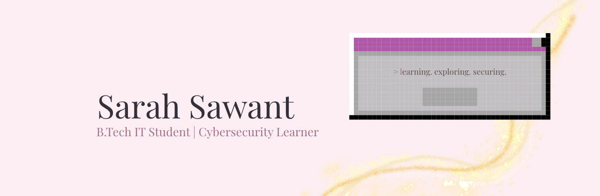
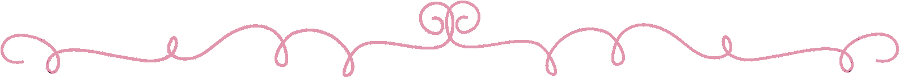

# Hey, I'm Sarah! 👋

I'm a B.Tech. IT student currently exploring the depths of cybersecurity.

Lately, I've been spending time understanding how networks work, experimenting with tools like Wireshark, and getting hands-on practice through TryHackMe.

I'm still learning, and this GitHub is where I document my journey — the things I build, the labs I complete, and the concepts I figure out along the way.

## 🌱 What I'm currently exploring

- Understanding networking fundamentals, IP addressing and subnetting.
- Exploring packet analysis and network traffic using Wireshark.
- Practising defensive security through TryHackMe.
- Learning how network protocols work and how attackers exploit them.
- Building practical cybersecurity skills through hands-on labs and documentation.

## 🛠️ Tech Stack

### 💻 Programming Languages

*Languages I've had some hands-on exposure to through college practicals.*

### 🔐 Cybersecurity & Networking

### 🔧 Tools & Platforms

## 🔍 My Cybersecurity Journey

I've been trying to move beyond just learning concepts and actually get hands-on experience with cybersecurity tools and platforms.

### 🔎 Wireshark
### 🔎 Wireshark

- [**Lab 01 — Network Traffic Analysis**](https://github.com/sarahsawant/cybersecurity-beginner-labs/tree/main/Wireshark/Lab-01-Network-Traffic-Analysis) — Capturing and exploring network traffic.
- [**Lab 02 — DNS Analysis**](https://github.com/sarahsawant/cybersecurity-beginner-labs/tree/main/Wireshark/Lab-02-DNS-Analysis) — Understanding how DNS queries and responses work.
- [**Lab 03 — TCP Three-Way Handshake Analysis**](https://github.com/sarahsawant/cybersecurity-beginner-labs/tree/main/Wireshark/Lab-03-TCP-Three-Way-Handshake) — Analysing TCP connection establishment through SYN, SYN-ACK and ACK packets.

### 🌐 Networking Fundamentals

- **Networking Fundamentals** — Documenting networking concepts and the fundamentals behind device communication.
- **Windows Networking Commands** — Practising commands such as `ipconfig`, `ping`, `nslookup` and `tracert`.

[Explore my cybersecurity lab repository](https://github.com/sarahsawant/cybersecurity-beginner-labs)

### 🛡️ TryHackMe

**Completed Rooms:**

- [**Intro to Defensive Security**](https://tryhackme.com/room/defensivesecurityintro) — Introduction to defensive security concepts.
- [**Intro to Offensive Security**](https://tryhackme.com/room/offensivesecurityintro) — Understanding the fundamentals of offensive security.
- [**Careers in Cyber**](https://tryhackme.com/room/careersincyber) — Exploring cybersecurity career paths.
- **Mystery Chest** — Completed.
- **Open Door** — Completed.
- [**What Is Networking?**](https://tryhackme.com/room/whatisnetworking) — Understanding networking fundamentals.
- **Subnetting** — Practising IP addressing and subnet calculations.

### 🎓 Certification

**Cisco – Introduction to Cybersecurity**

Completed the Cisco Introduction to Cybersecurity course and earned its official completion credential.

*Still learning, still experimenting, and documenting everything along the way. 🌷*
